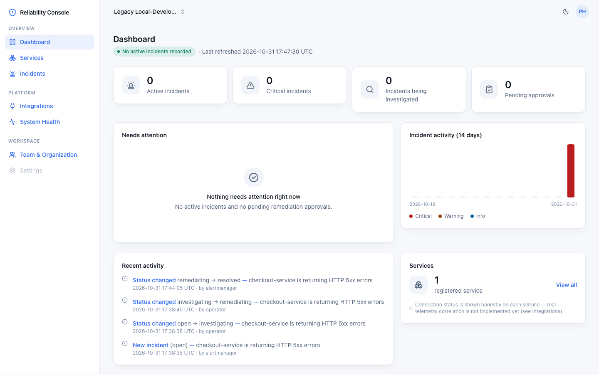
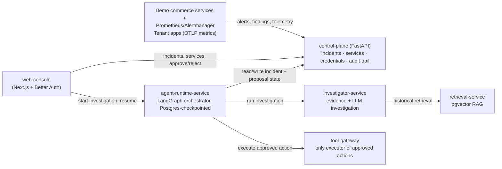
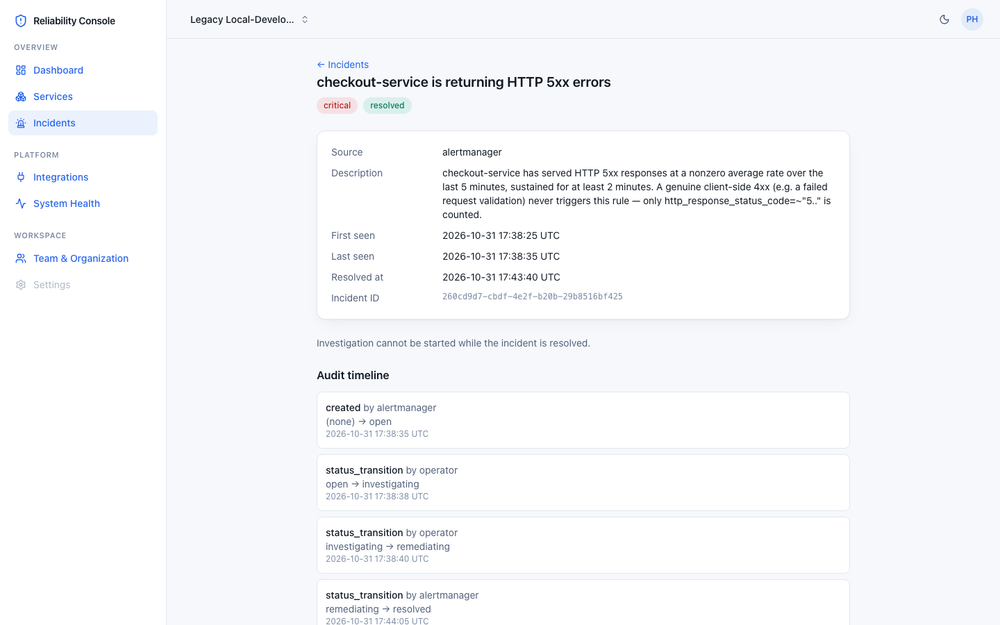
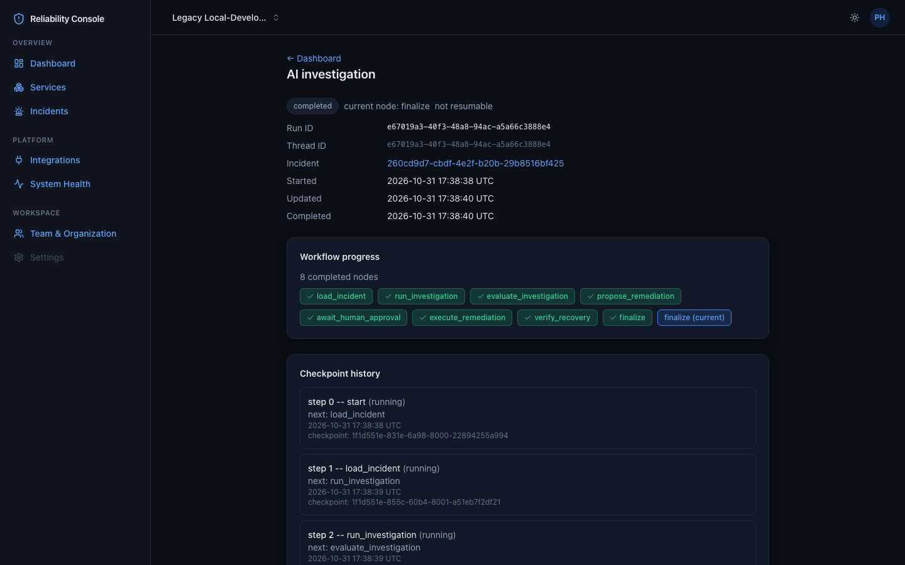
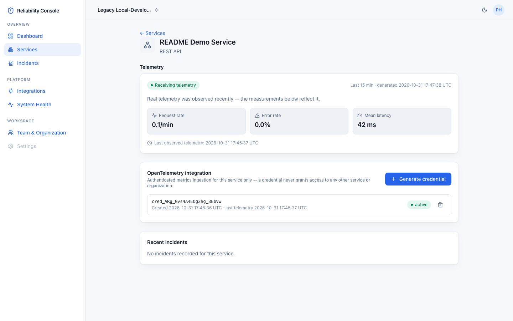

# Autonomous Production Reliability Platform

[](https://github.com/abheesh-03/autonomous-reliability-platform/actions/workflows/ci.yml)

An agentic SRE platform that watches a real distributed application, turns a firing alert into a durable incident, investigates it with an LLM-backed agent grounded in real evidence, and executes remediation only after a human approves it, recovery is re-verified and every step is written to an append-only audit trail.

**Live:** [reliability.abheesh.dev](https://reliability.abheesh.dev) — a real single-host deployment (see [Limitations](#limitations)). Try **[/demo](https://reliability.abheesh.dev/demo)** for a recorded, read-only walkthrough with no signup required.


*The organization dashboard: open incidents, recent activity, and services at a glance.*

## What it does

- **Detects** real operational incidents from Prometheus/Alertmanager alerts, a read-only Kubernetes observer, a read-only AWS observer, and tenant-submitted OpenTelemetry metrics.
- **Investigates** with an LLM agent (LangGraph, durable checkpointing) that gathers real evidence — metrics, logs, traces, and retrieved historical incidents (pgvector RAG) — and produces a structured report with hypotheses and confidence.
- **Proposes bounded remediation** from a small, explicit allowlist, never anything open-ended.
- **Requires human approval** before any remediation executes — no autonomous write action ever runs unsupervised.
- **Verifies recovery** after execution and records the outcome.
- **Keeps an append-only audit trail** of every incident transition, decision, and execution, attributable and durable.
- **Onboards external applications** through a secure, tenant-scoped web console: register a service, generate a credential, and send real OpenTelemetry HTTP metrics.

## The incident workflow

```
alert / finding / telemetry  →  incident created
        ↓
   evidence gathering  (metrics, logs, traces, retrieval)
        ↓
   AI investigation     (structured report, hypotheses, confidence)
        ↓
   human approval        (OWNER / INCIDENT_APPROVER only — gated, never bypassed)
        ↓
   bounded remediation   (one allowlisted action, executed via tool-gateway)
        ↓
   recovery verification  →  resolved, audit trail complete
```

Incident/audit state (`reliability.incidents` / `incident_events` / `remediation_proposals`) and the agent's own step-by-step progress are both durably checkpointed in PostgreSQL, never held only in memory. Crossing the human-approval gate, or resuming after any interruption, is always an explicit, separately-authenticated action (the console's "Run investigation" / "Continue workflow" buttons) — never automatic.

## Architecture

`agent-runtime-service` is the LangGraph orchestrator: it is the one service that actually drives an investigation through to remediation, calling out to `investigator-service` and `tool-gateway` as it goes and checkpointing every step to PostgreSQL. `web-console` and the alert/telemetry sources never call those two services directly.



PostgreSQL (with pgvector) is the single source of durable state for incidents, audit history, agent checkpoints, retrieval embeddings, and Better Auth's own session/organization tables. Kubernetes and AWS integration run as additional, read-only (or narrowly allowlisted) observation sources feeding the same pipeline — see [Limitations](#limitations).

## Quick start

```bash
cp .env.example .env
make check        # verify local prerequisites
make db-up        # start Postgres, provision app-role secrets, bring up the full stack
make db-migrate   # apply database migrations (Flyway)
make db-status    # wait for "healthy"
```

Then open the dashboard at **http://127.0.0.1:3101**. See [`docs/DEMO_WALKTHROUGH.md`](docs/DEMO_WALKTHROUGH.md) for a from-scratch walkthrough: signing up, creating an organization, registering a service, sending real telemetry, and triggering a demo incident. Prefer not to run anything locally first? The hosted [`/demo`](https://reliability.abheesh.dev/demo) above needs nothing installed.

## Documentation

- [Demo walkthrough](docs/DEMO_WALKTHROUGH.md) — a concrete, from-scratch path through the product.
- [Architecture overview](docs/architecture/system-overview.md) — full system design, with a per-phase architecture doc for every capability under `docs/architecture/`.
- [Telemetry onboarding](docs/architecture/phase-16-secure-telemetry-onboarding.md) — how external applications connect via OpenTelemetry.
- [Deployment](docs/architecture/phase-17a-deployment.md) ([runbook](deploy/README.md)) — the single-host deployment configuration.
- [Live deployment record](docs/architecture/phase-17b-deployment-handoff.md) — the real hosted instance: infrastructure, what was verified, and its honest limitations.

## Screenshots

<details>
<summary>Incident detail, investigation workspace, and service telemetry</summary>

| | |
|---|---|
|  *Incident detail: real timeline and evidence.* |  *AI investigation workspace, including remediation/recovery state.* |
|  *A registered service showing real received OpenTelemetry metrics.* | |

Capture details, including which screens used a deterministic (non-LLM) investigation provider, are recorded in [`docs/screenshots/PROVENANCE.md`](docs/screenshots/PROVENANCE.md).

</details>

## Limitations

- **Tenant telemetry is metrics-only.** External onboarding currently accepts authenticated OpenTelemetry HTTP server-request metrics (OTLP JSON/protobuf) — there is no tenant log or trace ingestion yet.
- **Remediation is deliberately narrow.** Every remediation action comes from a small, explicit allowlist and always requires approval from an OWNER or INCIDENT_APPROVER; nothing autonomous ever writes to production.
- **Kubernetes and AWS integration are read-only observers**, operator-configured (not self-service), feeding the same incident/investigation pipeline. Kubernetes additionally supports exactly one allowlisted, human-approved remediation action (restarting a specified Deployment); AWS supports detection and investigation only — it can never authorize remediation.
- **Deployment is a single-host MVP, now live.** The hosted instance above runs on a single 2 vCPU/4 GB VPS — no high availability, no horizontal scaling, no sustained-load or production SLA claim. Database backups are currently manual (not yet shipped off-host automatically), and telemetry retention runs in dry-run mode. See [the live deployment record](docs/architecture/phase-17b-deployment-handoff.md) for the full, honest detail.
- **LLM use is configurable.** Investigation can run against a real LLM provider or a deterministic stub (used throughout CI and for some of the screenshots above — see the provenance note); either way, the investigation report structure and approval/remediation flow are identical.
- **No self-service onboarding for Kubernetes or AWS.** Only OpenTelemetry metrics onboarding is currently self-service through the web console.


## Copyright and permissions

Copyright © 2026 Sai Abheesh Annaiah. All rights reserved.

This repository is public for portfolio review. No general license is granted to reuse, modify, redistribute, or commercialize its original code or documentation. Rights granted by GitHub's Terms of Service and applicable law remain unaffected. Third-party components retain their respective licenses. For additional permissions, contact [@abheesh-03](https://github.com/abheesh-03).

---

*Built incrementally, phase by phase, through Phase 18. Full history is in `git log` and `docs/architecture/`.*
